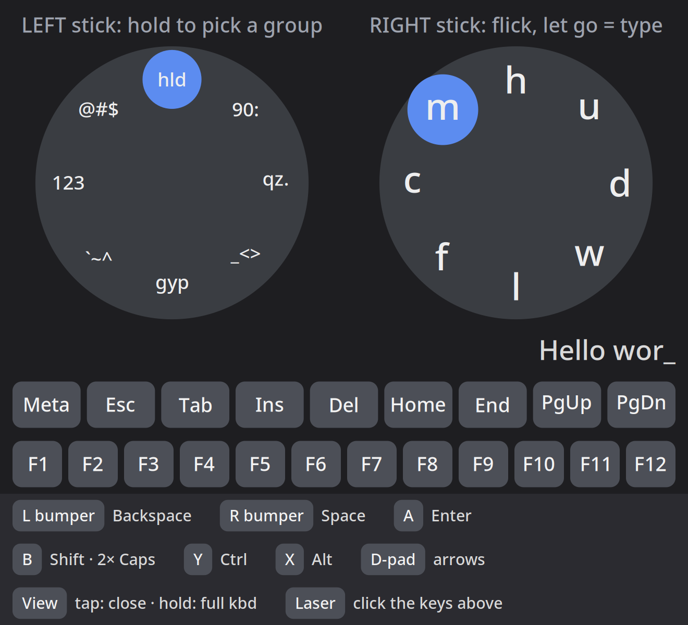

# ft-vrkeys

On-screen keyboards for typing on a Steam Frame's [Frametop](https://github.com/Frametop/frametop) desktop with only the controllers in hand.



- **ft-chord**: a chord keyboard. Hold the left stick in a direction to pick a group of 8 characters, then flick the right stick and let go to type one. With the left stick centred, the right stick types the 8 most common letters (e t a o i n s r). Bumpers are Backspace and Space, A is Enter, B is Shift (twice for Caps), Y and X are Ctrl and Alt, and the left d-pad gives arrows. Two rows of keys on the HUD, clicked with the laser, have Meta, Esc, Tab, Ins, Del, Home, End, PgUp, PgDn and F1-F12. The legend on the HUD shows all of this. The sticks also scroll whatever the laser points at, so close the HUD (tap the left view button) when you want to scroll.
- **ft-keyboard**: a full 104-key keyboard (F-keys, navigation block, numpad) as a floating window.
- **ft-chord --watch**: watches the left view button. A tap toggles ft-chord, and a hold toggles ft-keyboard.

ft-chord reads the controllers from vrserver's local web socket (127.0.0.1:27062), because SteamVR's overlay input doesn't reach overlay apps on the Frame. It sends keys through Frametop's compositor (`@ft_screens`).

## Install

### Option 1: Recreate it with an AI agent

Give [ft-chord-recreate-prompt.txt](ft-chord-recreate-prompt.txt) to your AI agent of choice on the Steam Frame, along with the two images in `images/`. The prompt covers checking the environment, the setups with and without Frametop, and what I found by testing, so the agent can build ft-chord in one pass.

### Option 2: Install these files

Requires Frametop. It uses the system Python, GTK4 and pycairo, which come with SteamOS.

```
cp ft-chord ft-keyboard ~/.local/bin/
cp applications/*.desktop ~/.local/share/applications/
cp systemd/ft-chord-watch.service ~/.config/systemd/user/
systemctl --user daemon-reload && systemctl --user enable --now ft-chord-watch
```

So the windows never take keyboard focus, add a KWin rule to `~/.config/frametop/kwinrulesrc` for each app id (`local.ft.chord`, `local.ft.keyboard`) with `acceptfocus=false` and `acceptfocusrule=2`. [ft-chord-recreate-prompt.txt](ft-chord-recreate-prompt.txt) has the full rule.

## Other files

- `ft-chord-recreate-prompt.txt`: a prompt for an AI agent to rebuild ft-chord from scratch on a Steam Frame, with or without Frametop, including what I found by testing.
- `probe/`: the test tools I used to find a working way to read the controllers. `probe.cpp` tries SteamVR input, which didn't work, and `wsprobe.py` reads the web socket, which did.
